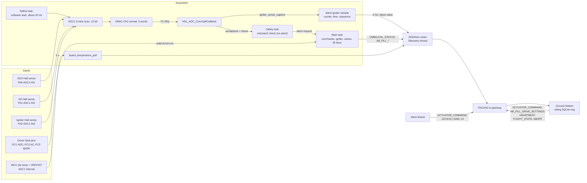
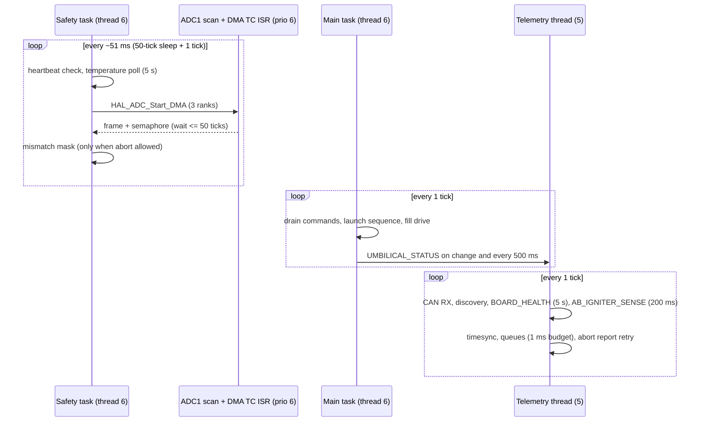
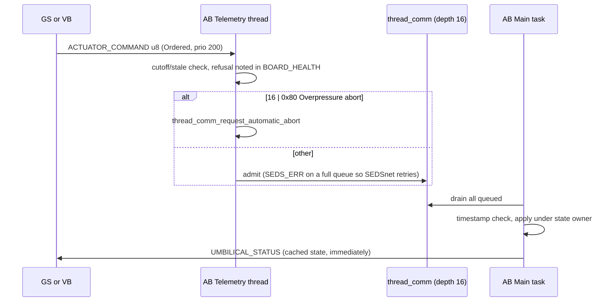

# Actuator Board data pipeline

This document traces every Actuator Board (AB) input and output report, from
the pin to where the Ground Station (GS) stores it. Every number below comes
from the source. File and line references are relative to this repository
unless they name `GroundStation26/`. Values were checked against the `dev`
branch on 2026-11-22.

The AB has **no SD card and no data log**. Everything that is kept goes over
SEDSnet to the GS. The board's analog inputs are three Hall current-sense
channels. They are electrical observations only:

- The N2O and N2 channels are compared against expected output state, and the
  comparison never aborts.
- The igniter channel is published as `AB_IGNITER_SENSE`.

The AB has no igniter continuity measurement. The only igniter check is the
driver fault pin, read once before the igniter is enabled.

## 1. Overview

The sampling, control and publishing schedule:

## 2. Threads, ISRs, timers and DMA

ThreadX ticks at 1000 Hz (`Core/Inc/tx_user.h:240`). A lower number means a
higher priority. No thread uses time slicing.

| Context | Priority | Period / trigger | Work | Source |
|---|---|---|---|---|
| Telemetry thread | 5 | `tx_thread_sleep(1)` loop | CAN RX drain, `board_health_poll` + `igniter_sense_poll` inside discovery polling, timesync, OTA, `process_all_queues_timeout(1)`, abort report (at most 1/s), ADC-start warning (at most every 10 s) | `Core/Src/telemetry_thread.c:127-192`, `Core/Src/telemetry.c:927-933` |
| Main task | 6 | `tx_thread_sleep(1)` loop; 10 ticks while aborted | Drains all queued commands, Launch sequence, fill drive, status publication | `Core/Src/main_task.c:596-689` |
| Safety task | 6 | 50 ticks (`SAFETY_CHECK_PERIOD_TICKS`) + ADC wait | GS heartbeat timeout (5000 ms), die temperature, ADC1 scan, mismatch check | `Core/Src/safety_task.c:19-25,377-415` |
| DMA1_Channel1 IRQ (ADC1) | NVIC 6 | end of each 3-rank scan | Captures the igniter sample, posts the frame and semaphore | `Core/Src/main.c:563`, `Core/Src/safety_task.c:422-440` |
| TIM1 update IRQ | NVIC 5 | stepper step timer (1 MHz count, ARR = period − 1) | Stepper pulse counting for plumbing retract | `Core/Src/stm32g4xx_hal_msp.c:100`, `Drivers/stepper_stuff/stepper_driver.c:75,224` |
| FDCAN2 IT0/IT1 IRQ | NVIC 6 | CAN RX/TX | Fills a 64-frame RX ring | `Core/Src/stm32g4xx_hal_msp.c:328-330`, `Core/Src/can_bus.c:180` |
| USB_LP IRQ | NVIC 5 | USB | CDC debug | `Core/Src/stm32g4xx_hal_msp.c:476` |
| TIM6 (HAL tick) | NVIC 15 | 1 kHz | `HAL_IncTick` | `Core/Inc/stm32g4xx_hal_conf.h:184` |

ADC1 is in scan mode with 3 conversions, software start, no continuous mode and
2.5-cycle sampling (`Core/Src/main.c:227-290`). DMA is normal mode on
DMA1_Channel1 (`Core/Src/stm32g4xx_hal_msp.c:175-182`). Each loop of the safety
task starts exactly one scan, so the sample rate equals the loop rate: about
1000 / (50 + 1) ≈ 19.6 Hz.

## 3. Channels and streams

### 3.1 Analog and digital inputs

| Item | Igniter current sense | N2O current sense | N2 current sense | Driver fault pins | Die temperature / VDDA |
|---|---|---|---|---|---|
| Sensor | ACS71240-045B5 + unity buffer (`docs/igniter-sense.md`) | ACS711 + ×28 amplifier (`docs/hall-current-sense-audit.md`) | same as N2O | driver FAULT outputs | STM32 TS, VREFINT |
| Pin / ADC | PA2, ADC1 IN3, rank 3 | PA0, ADC1 IN1, rank 1 | PA1, ADC1 IN2, rank 2 | PC1 (N2O), PC2 (N2), PC3 (igniter), active low (`solenoid_driver.c:26-28`, `igniter_driver.c:24-27`) | ADC1 internal |
| Sample rate | ≈ 19.6 Hz | ≈ 19.6 Hz | ≈ 19.6 Hz | read once per turn-on request | 0.2 Hz (`board_temperature.c:14-17`) |
| Read rate | 5 Hz publish of the newest sample (`igniter_sense.c:41`) | each sample, while abort is allowed | same | – | 5 s |
| Filtering | none. Latest value; decimated about 4:1, no averaging | none | none | none | none |
| Processing | raw counts. Valid when not faulted and age ≤ 250 ms. Saturated at 0 or 4095. VDDA from VREFINT, valid 1620–3600 mV and age ≤ 6000 ms (`igniter_sense_math.h:88-134`) | compared with the expected output: closed 0–128 counts, open 256–4095 (`safety_task.c:31-42,266-276`) | same limits (`safety_task.c:44-55`) | `solenoidOn`/`igniterOn` refuse when the pin is low | factory calibration |
| Units / calibration | counts and VDDA mV. Amperes are explicitly unsupported (`IGNITER_SENSE_FLAG_CURRENT_UNSUPPORTED`) | counts, uncalibrated | counts, uncalibrated | – | 0.01 °C |
| SD save | none | none | none | none | none |
| Network type | `AB_IGNITER_SENSE` (id 106291377, u32×12) | none. Only the internal mismatch mask | none | none | `BOARD_HEALTH` word 1 |
| Send rate | ≤ 5 Hz | – | – | – | 5 s; 200 ms when a new command refusal is pending (`board_health.c:31-33`) |
| Reliability / priority | reliable Off, priority 0, GROUND_STATION (`config/sedsnet.json`) | – | – | – | Off, 0 |
| Egress | `seds_router_log_bytes_ex(..., true)` from the telemetry thread (`igniter_sense.c:65-66`). CAN data band `0x105` (`board_can_priority.h`). Frames older than 1000 ms are dropped (`can_tx_queue.c:11,105-108`) | – | – | – | same |
| Latency | ≤ 51 ms sample age + ≤ 200 ms publish phase. The sample time is carried in the payload | – | – | turn-on only | ≤ 5 s |

`AB_IGNITER_SENSE` words (`Core/Src/igniter_sense.c:59-64`):

| Word | Content |
|---|---|
| 0 | version 1 |
| 1 | flags |
| 2–3 | boot id |
| 4 | sequence |
| 5–6 | sample uptime ms |
| 7 | raw counts |
| 8 | VDDA mV |
| 9 | sample age ms |
| 10 | reference age ms |
| 11 | hardware profile 1 |

Flag bits: 1 sample valid, 2 reference valid, 4 saturated, 8 current
unsupported, 16 ADC fault.

ADC2 IN3 (PA6, `H_BRIDGE_ADC`) is configured (`Core/Src/main.c:312-337`) but
never started or read.

### 3.2 Output state and fill-drive streams

| Stream | SEDSnet type (reliable, priority) | Trigger / rate | Payload | Source |
|---|---|---|---|---|
| Output state | `UMBILICAL_STATUS` (Ordered, 200) | Immediately after each change. All four are published every 500 ms (`UMBILICAL_STATUS_PERIOD_TICKS`). Failed reports retry every 100 ms with the latest cached value | `[cmd_id, 0/1]`. IDs: 7 igniter, 8 plumbing retracted, 9 N2 open, 10 N2O open. The state is the **cached software state** (`g_igniter_on` and the others), not a register readback. Submitted at once on the calling task, stamped by router network time (`telemetry.c:983-1013`) | `main_task.c:47,87-109`, `Core/Inc/status_report_retry.h:17-41` |
| Fill drive status | `AB_FILL_DRIVE_STATUS` (Ordered, 200, 40 B) | Reply to each `AB_FILL_DRIVE_SETTINGS` v1 query or set. Result retries every 100 ms until accepted | result, mode, epoch, busy, remaining ms, identity | `Core/Src/fill_settings.c:98-111,198-215` |
| Fill motion status | `AB_FILL_MOTION_STATUS_V2` (Ordered, 200, 56 B) | Reply to a version-2 query | snapshot including provenance and remaining ms of the 45 s window | `Core/Src/fill_settings.c:90-97`, `Core/Inc/fill_motion.h:9` |
| Automatic abort | `ABORT` string | Once per abort epoch, retried at most 1/s | `SEDS_AUTO_ABORT_V1:<reason>` | `Core/Src/telemetry_thread.c:88-125` |
| ADC start failure | `WARNING` | at most every 10 s | fixed text | `Core/Src/telemetry_thread.c:73-86` |
| Health | `BOARD_HEALTH` (Off, 0) | 5 s, or 200 ms on a new refusal | uptime, watchdog, allocator, CAN TX/RX counters, last refusal (words 16–18), die temperature | `Core/Src/board_health.c:20-70` |

### 3.3 Commands and acknowledgements

- Command IDs (`Core/Inc/board_commands.h`): 7 igniter on, 8 retract plumbing,
  9 N2 open, 10 N2O open, 11 igniter off, 12 N2 close, 13 N2O close, 14
  igniter (Launch) sequence, 15 extend plumbing (only invalidates provenance),
  16 overpressure abort.
- Bit 0x80 tags an automatic command, accepted only for 9, 10, 12, 13 and 16
  (`telemetry.c:288-297`). The VB sends 12 | 0x80, 13 | 0x80 and 16 | 0x80 on
  an overpressure relief trip, and 14 at Launch acceptance.
- Refusals: a stale command, an abort, an unready store or an out-of-date
  timestamp is refused with a reason code. The latest refusal is published in
  `BOARD_HEALTH` words 16–18 within 200 ms (`main_task.c:412-428`,
  `board_health.c:31-55`).
- Igniter Launch sequence: the igniter turns on at a deadline fixed when the
  Launch is accepted. That deadline is receipt + `THREAD_COMM_LAUNCH_EFFECT_DELAY_MS`
  = 4250 ms, or the stored accepted-launch deadline (`thread_comm.h:31`,
  `main_task.c:326-332`, `thread_comm.c:131-134`). The igniter stays on for
  10 000 ms, followed by a 1500 ms restart holdoff (`main_task.c:48-52,334-369`).
- Plumbing retract (stepper mode): 20 000 000 steps at a 30 µs period. The
  timer counts at 1 MHz, so the step rate is 33.3 kHz (`main_task.c:55-58`).
  Aux mode instead holds `BACKUP_VALVE_EN` for 45 s (`fill_motion.c:11-14`).
- Board-side latency from command receipt to output change: one telemetry
  loop plus one main-task pass, ≈ 1–2 ms.

### 3.4 Safety logic

| Function | Rule | Debounce / latency | Source |
|---|---|---|---|
| Heartbeat abort | no GS heartbeat for 5000 ms while Idle < state < Launch | checked about every 51 ms | `safety_task.c:23,301-332` |
| Initial heartbeat abort | no heartbeat ever, for 5000 ms after entering an active state | same | `safety_task.c:334-347` |
| Hall mismatch | 10 consecutive mismatching scans (about 0.5 s) set the counter limit, but the abort is **commented out** | none | `safety_task.c:25,350-375` |
| Overpressure abort | `ACTUATOR_COMMAND` 16 \| 0x80 from the VB or GS → automatic abort | immediate | `telemetry.c:290-293` |
| Abort safe state | igniter, N2, N2O, backup valve and H-bridge enables low; stepper asleep. Statuses every 500 ms | main loop runs every 10 ticks while aborted | `main_task.c:167-188,631-652` |

## 4. Where each stream is stored

### 4.1 Summary

| Stream | Saved on the AB | Reaches the GS | Saved by the GS |
|---|---|---|---|
| `AB_IGNITER_SENSE` | no | yes | raw packet row, plus derived `IGNITER_SENSE_STATUS` and `IGNITER_SENSE_SIGNAL` rows |
| `UMBILICAL_STATUS` 7–10 | no | yes | synthetic `VALVE_STATE` row (igniter, N2, N2O, retract) |
| `AB_FILL_DRIVE_STATUS`, `AB_FILL_MOTION_STATUS_V2` | the drive selection is persisted in internal flash (`fill_settings.c:155-175`) | yes | in memory and `backend/data/actuator_plumbing.json`; **not in recordings** |
| `BOARD_HEALTH` | no | yes | raw row with the payload |
| `ABORT`, `WARNING` | no | yes | abort history; `alerts` table |
| N2O/N2 Hall counts | no | no | – |

### 4.2 Ground Station

All paths are in `GroundStation26/backend/src/`.

- **Decode.**
  - `UMBILICAL_STATUS` is handled at ingress (`main.rs:2089-2130`) and
    accepted only when cmd 7–13 comes from `AB` (`telemetry_task.rs:2357-2363`).
    It is applied to the `VALVE_STATE` row (`telemetry_task.rs:2099-2121`).
  - Fill drive and motion status go to `actuator_plumbing::receive_status` and
    `receive_motion_status`, then return early, before the recorder
    (`main.rs:2074-2084`).
  - `AB_IGNITER_SENSE` goes to `igniter_sense::observe`
    (`telemetry_task.rs:3134-3200`). Volts = counts · VDDA / (4095 · 1000).
  - `BOARD_HEALTH` also feeds the AB command gate (`telemetry_task.rs:2850-2852`).
- **Rolling recording.** SQLite segments of 64 MB in
  `data/recordings/rolling/segment_<UTC>.db`, with a ring budget of up to 50 GB
  (`recording_store.rs:190-244`). Every decoded sample is kept with its raw
  packet (`telemetry_task/derived.rs:47-54`). Rows are batched by 256 rows or
  8 ms.
- **Event captures.** Every table row in the window is copied to
  `data/recordings/events/<kind>/<stamp>_<label>/recording.db`. Windows
  (pre/post): Launch 600/300 s, Abort 300/300 s, Igniter 120/120 s, Fill
  120/120 s (`recording_store.rs:127-161`). Fill drive status never appears
  in a capture.
- **Burn report.** The GS has no dedicated burn report. The generic report
  studio (`recording_report.rs`) renders `VALVE_STATE` and the igniter rows on
  request and stores nothing.
- **Board SD attachments.** The AB has no SD card. The GS attaches only FC
  (`irec*`) and DAQ (`DAQ*`) CSV files (`recording_store/board_sd.rs:58-74`).
- **Command confirmation.** The GS sets a pending target and clears it when a
  matching `UMBILICAL_STATUS` arrives. After 5000 ms without a match, both the
  pending and confirmed state are dropped (`state.rs:33-34`).

## 5. Known gaps and bugs found

No firmware was changed. Items are ordered by operational impact.

1. **Hall mismatch protection is disabled.** The abort at 10 mismatches is
   commented out (`Core/Src/safety_task.c:371-374`). The closed band of 0–128
   counts cannot be met by the fitted analog chain: the ACS711 midpoint with
   ×28 gain saturates (`docs/hall-current-sense-audit.md`). The check counts
   mismatches and does nothing else.
2. **Status reports a cached state, not hardware.** `UMBILICAL_STATUS` sends
   `g_nitrogen_open`, `g_nitrous_open` and `g_igniter_on`
   (`main_task.c:87-93`, `status_report_retry.h:17-27`). The VB instead reads
   registers back. Neither board proves physical valve position.
3. **SIG pins are inputs but are written as outputs.** `N2_SIG` (PB13),
   `N20_SIG` (PB14) and `IGNITER_SIG` (PB12) are configured as `GPIO_Input`
   (`Core/Src/main.c:636-638`, `ActuationBoard.ioc:229-240`). The solenoid
   driver and safe-off paths nevertheless call `HAL_GPIO_WritePin` on them
   (`Drivers/sol_stuff/solenoid_driver.c:4,16,22`, `main_task.c:159-161,177-179`).
   Recovery reports their ODR bits as outputs (`main_task.c:474-475`). An ODR
   write on an input pin has no electrical effect. Either the pins are
   feedback lines that firmware never reads, or the pin configuration is
   wrong. Confirm against `Schematic.pdf`.
4. **Misleading warning text.** The ADC-start warning says "continuity sensing
   unavailable" (`telemetry_thread.c:81`). The AB ADC measures Hall current
   sense, not continuity.
5. **No igniter continuity data.** The fault pin is read only inside
   `igniterOn` (`igniter_driver.c:8-16`) and is never published.
   `AB_IGNITER_SENSE` reports raw counts with amperes flagged unsupported.
   The GS docs say amperes are recorded as unavailable
   (`GroundStation26/docs/igniter-sense.md`), but the GS code stores an
   uncalibrated nominal estimate in that slot
   (`GroundStation26/backend/src/igniter_sense.rs:1-20,213-219`).
6. **Igniter sense is decimated without a filter.** The ≈ 19.6 Hz scan
   samples a single point (2.5-cycle sampling time). Only the newest sample
   is published, at 5 Hz.
7. **Fill drive history is not in recordings.** `AB_FILL_*` status packets
   return before the recorder (`GroundStation26/backend/src/main.rs:2074-2084`),
   so captures and reports cannot show drive state.
8. **Unbounded command drain.** The main task drains every queued command in
   one pass (`main_task.c:654-657`). The VB limits this to 4 per pass. With
   the queue depth of 16 this is bounded, but one pass can be long.
9. **Unused configured ADC.** ADC2 IN3 (`H_BRIDGE_ADC`) is configured but
   never sampled (`main.c:312-337`).
